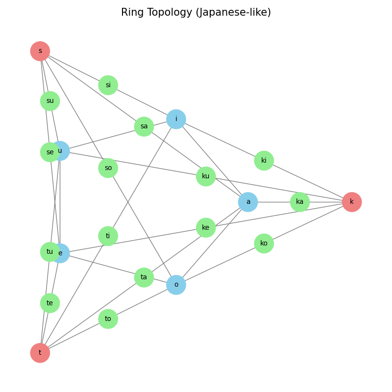
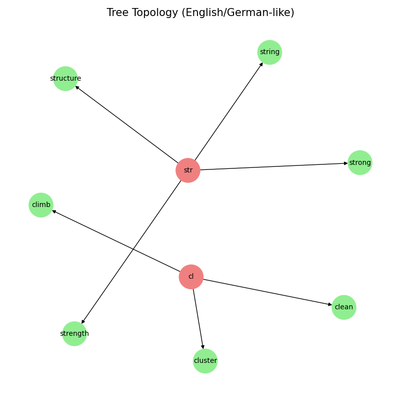
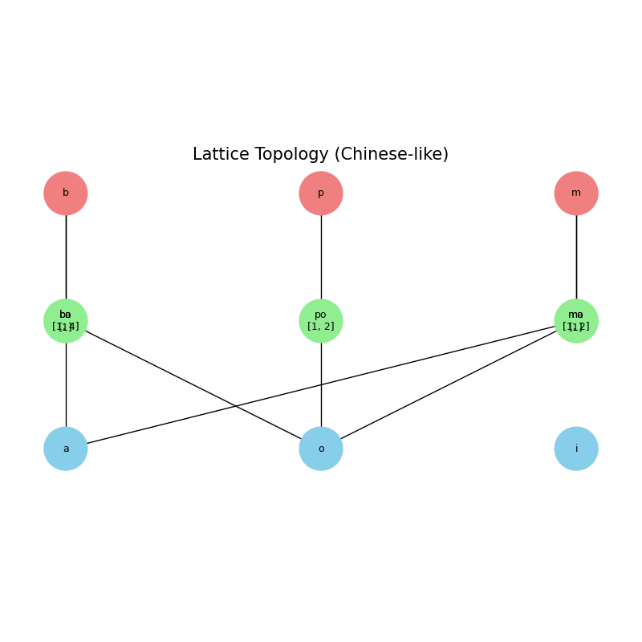
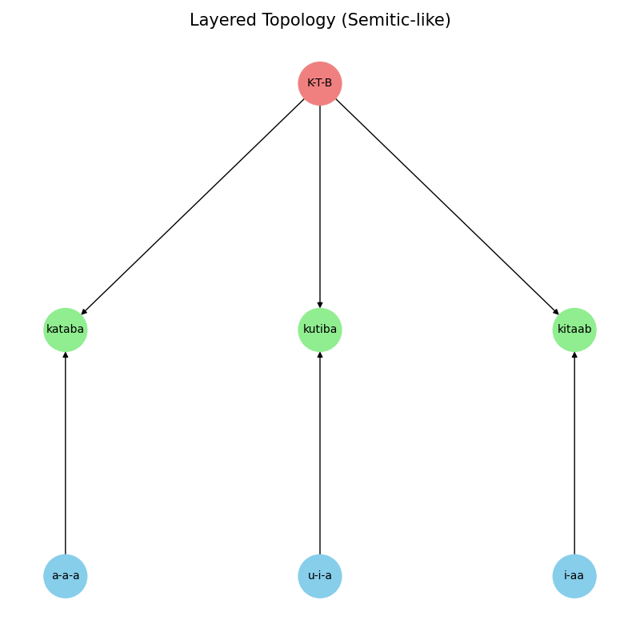

# Phonosematic Computational Topologies: A Network-based Typology of Phonological Structures

## Abstract

本稿は、自然言語の音韻構造をネットワーク科学の視点から分析し、そのトポロジー（位相的構造）に基づいて言語を類型化する新たなフレームワークを提案するものである。伝統的な言語学における樹状構造モデルや線形配列モデルとは異なり、本アプローチでは音素や音節をノード、それらの関係性をエッジとするグラフとして言語をモデル化する。分析の結果、言語の音韻構造は「星型」「環型」「樹型」などの純粋型トポロジーの組み合わせである「混成型トポロジー」として最もよく記述できることを明らかにした。さらに、各トポロジーが有限状態機械、グラフ探索、テンソル代数といった特定の計算モデルと強く対応することを示し、この知見が言語特性に最適化された自然言語処理システムの設計に貢献しうることを論じた。

---

## 1. Introduction

言語の構造分析は、伝統的に統語論における樹状構造（ツリー構造）や、音韻論・形態論における線形配列（シーケンス）に焦点を当ててきた。これらのモデルは言語の階層性や順序性を捉える上で強力なツールであるが、音素間の共起関係、派生関係、あるいは言語全体にわたる音響的・構造的パターンといった、より複雑な関係性を捉えるには限界があった。

本稿では、この課題に対し、ネットワーク科学の概念を応用した「音韻トポロジー」という新たな視点を提案する。このアプローチでは、言語の音韻システムを、音素や音節といった基本単位をノードとし、それらの間に存在する関係性をエッジとするネットワーク（グラフ）として捉え直す。このモデル化により、各言語が持つ固有の「形」——すなわちトポロジー——を可視化し、比較分析することが可能となる。

本稿の目的は、この音韻トポロジーに基づいた言語の類型論を構築することにある。まず、構造の基本要素となる複数の「純粋型トポロジー」を定義し、次に、現実の言語がこれらの要素をいかに組み合わせた「混成型トポロジー」として成立しているかを明らかにする。この試みは、言語の多様性と普遍性を新たな次元で理解するための一助となるだろう。

---

## 2. Theoretical Framework

### 2.1. Phonological Systems as Networks

音韻トポロジーモデルは、以下の要素から構成される。

*   **ノード (Node)**: 分析の粒度に応じて、音素（母音、子音）、音節、あるいは形態素といった言語の基本単位を表す。
*   **エッジ (Edge)**: ノード間に存在する関係性を表す。代表的なものに、音節内での共起関係（例：`C-V`）、形態素の派生関係（例：`strong` → `strength`）、あるいは歴史的な音韻変化などがある。

このフレームワークを用いることで、例えばある言語の音韻システムは、特定の音素が中心的なハブとなる「スター型」ネットワークや、音素が周期的に連なる「環型」ネットワークとして表現される。

### 2.2. A Computational Model: Vowel Phase Spaces and Consonant Operators

本稿で提案するネットワークモデルの根底には、言語の動的な生成プロセスを捉えるための計算論的メタファーが存在する。それは、言語の基本要素である**母音**をシステムの安定状態を記述する**「位相空間（Phase Space）」**として、**子音**をその空間内で状態遷移を引き起こす**「作用素（Operator）」**としてモデル化するものである。

#### 母音：位相空間としての役割

位相空間（または状態空間）とは、あるシステムが取りうる全ての状態の集合である。言語の音韻生成において、母音は発声の核となる安定した状態と見なすことができる。

*   **状態の定義**: 各母音（例：/a/, /i/, /u/, /e/, /o/）は、この空間における個別の「状態」または「点」に対応する。
*   **空間の構造**: 日本語のように母音の数が明確に定まっている言語では、位相空間は有限の離産点の集合としてモデル化できる。一方、英語のように二重母音や曖昧母音（シュワ）が存在し、母音間が連続的に変化する場合、位相空間はより高次元の連続多様体（manifold）として捉える方が現実に即している。

#### 子音：作用素としての役割

作用素とは、ある空間の点（状態）を別の点（状態）へ変換する写像（関数）である。子音は、単独では安定した音節を形成せず、母音という状態に「作用」することで初めて具体的な音（音節）を生成する変換子と見なせる。

*   **作用の定義**: 子音は、母音の位相空間に作用し、具体的な音節へと写像する (`Operator_k(State_a) -> Syllable_ka`)。
*   **作用素の性質**: 子音作用素は、母音空間における線形変換（遷移行列）や、プログラミングにおける関数として形式化できる。

この「母音＝位相空間、子音＝作用素」というモデルは、本稿で後述する各言語トポロジーの計算論的本質を理解するための基礎となる。

---

## 3. A Typology of Phonological Topologies

世界の言語に見られる多様な音韻構造は、いくつかの理想的な「純粋型」トポロジーに分類できる。以下に主要な類型を挙げる。

### 3.1. Archetype Topologies

1.  **星型 (Star-like)**
    *   **構造**: 特定のノード（主に母音）が中心的なハブとなり、他の多数のノードが放射状に接続する。
    *   **代表例**: フランス語、スペイン語（母音核が強く、多くの子音と結合する）。
    *   **特徴**: ネットワークの平均距離が短く、予測性が高い。音節構造が安定する。

2.  **環型 (Cyclic / Ring)**
    *   **構造**: ノードが循環的な経路を形成する。特に母音システムに見られる。
    *   **代表例**: 日本語（五母音の循環）、イタリア語（母音環と促音ループ）。
    *   **特徴**: 拍リズムや韻律との親和性が高く、詩や歌に適した構造を持つ。

3.  **樹型 (Tree-like)**
    *   **構造**: 特定のノード（主に子音クラスター）を根（ルート）として、階層的な分岐構造を形成する。
    *   **代表例**: 英語、ドイツ語（`str-`, `cl-` などの子音クラスターから多数の語彙が派生）。
    *   **特徴**: 複合語や派生語の生成が容易で、語彙の拡張性に富む。

4.  **格子型 (Lattice-like)**
    *   **構造**: 2種類以上のノード群が直交的に配置され、格子状のネットワークを形成する。
    *   **代表例**: 中国語（子音×母音の音節格子に声調が重畳）、ヒンディー語（有気/無気などの特徴格子）。
    *   **特徴**: 規則性が高く、音節単位での網羅的な生成が可能。

5.  **層型 (Layered / Multiplex)**
    *   **構造**: 同一のノード集合に対して、異なる種類の関係性を示す複数のエッジ層が並行して存在する。
    *   **代表例**: ロシア語（硬子音層と軟子音層が並行）、セム語族（三子音からなる語根層に母音パターン層が射影される）。
    *   **特徴**: 柔軟な音素変化と豊富な語形派生能力を持つ。

6.  **直列型 (Linear / DAG)**
    *   **構造**: ノードが有向非巡回グラフ（DAG）を形成し、一方向的に連なる。
    *   **代表例**: トルコ語などの膠着語（語幹に接尾辞が次々と付加される）。
    *   **特徴**: 文法規則が決定論的で予測性が高い。

### 3.2. Network-Theoretic Types

上記に加え、ネットワーク全体の統計的性質に基づく類型も存在する。

*   **小世界型 (Small-world)**: ノード間の平均経路が短く、クラスター性が高い。学習効率が良い（例：ピジン語）。
*   **スケールフリー型 (Scale-free)**: 次数分布がべき乗則に従い、少数のハブがネットワーク全体を支配する（例：英語の母音シュワ /ə/）。
*   **モジュール型 (Modular)**: ネットワーク内に密に結合したサブグループ（コミュニティ）が複数存在する（例：バントゥ諸語の名詞クラス）。
*   **完全グラフ型 (Clique)**: 少数の音素がほぼ全ての組み合わせを許容する（例：ハワイ語）。
*   **遊走型 (Random walk)**: ネットワークのリンクが時間と共に動的に変動する（例：大母音推移）。

---

## 4. Analysis of Hybrid Topologies in Natural Languages

現実の自然言語は、単一の純粋型トポロジーで説明できることは稀であり、その多くは複数の類型が組み合わさった「混成型トポロジー」として理解される。本セクションでは、主要な言語を例に、その混成構造を分析する。

### 4.1. 日本語: 環 × 樹 (Cyclic × Tree)

*   **構造**: 五母音が安定した**環状**のハブ（位相空間）を形成し、それぞれの子音（作用素）がそのハブから**樹状**に分岐して音節ファミリー（カ行、サ行など）を形成する。
*   **特徴**: 安定した拍リズム（環）と豊かな語彙分化（樹）が共存する。
*   **可視化**:

    

### 4.2. 英語: 星 × 樹 (Star × Tree)

*   **構造**: 曖昧母音シュワ `/ə/` がネットワークの中心となる巨大な**星型**ハブを形成し、無数の単語を低コストで接続する。一方で、`str-`, `cl-`, `spr-` といった子音クラスターは、特定の意味領域を支配する**樹状**の根となる。
*   **特徴**: ハブによる効率的な接続性と、クラスターによる意味的な深掘りが両立している。
*   **可視化**:

    

### 4.3. 中国語: 格子 × 環 (Lattice × Cyclic)

*   **構造**: 子音（声母）と母音（韻母）が直交する**格子状**の音節空間を形成する。この二次元空間に対し、声調（四声）が時間的な**環状**ループ（上昇、下降、平坦、屈曲）として作用し、意味を分化させる。
*   **特徴**: 音節の網羅性（格子）と、時間波形による意味分化（環）を組み合わせる。
*   **可視化**:

    

### 4.4. セム語族: 層 × 格子 (Layered × Lattice)

*   **構造**: `K-T-B`（書く）のような三子音語根が、意味の基盤となる安定した**層**を形成する。この語根層に対し、時制や態を変化させる母音パターン（例: `a-a`, `u-i`, `i-a-`）が**格子状**に射影され、多様な派生語を生み出す。
*   **特徴**: 安定した意味基盤（語根層）と、柔軟で体系的な文法機能（母音格子）を両立させている。
*   **可視化**:

    

---

## 5. Computational and Engineering Implications

本稿で提案するトポロジー類型は、単なる理論的な分類に留まらず、言語処理技術や計算モデルと強い対応関係を持つ。この対応関係を理解することは、各言語の特性に最適化されたアルゴリズムを設計する上で重要な指針となる。

| トポロジー | 位相空間 (母音) | 作用素 (子音) | 計算モデル |
| :--- | :--- | :--- | :--- |
| **環型 (日)** | **Z_5巡回群**に対応する離散5点空間。状態は周期的に遷移可能。 | 各子音が母音空間全体に作用し、音節の**平行移動**や**回転**を引き起こす。 | **有限状態機械 (FSM)**、**巡回行列**による変換、フィードバック制御。 |
| **樹型 (英)** | 高次元で**連続的**な多様体。シュワ(/ə/)が原点に近い**特異点**。 | 子音クラスタ(str-, cl-)が**分岐作用素**として機能し、多様体上に**階層的な枝**を生成する。 | **グラフ探索アルゴリズム (DFS/BFS)**、**トライ木**、階層的クラスタリング。 |
| **格子型 (中)** | 母音/韻母が直交基底を成す**ベクトル空間**。 | 子音/声母が基底ベクトルを選択し、声調が**スカラー倍**や**複素回転**のような追加作用を及ぼす。 | **テンソル積**、**線形代数**における基底変換、時系列信号処理。 |
| **層型 (セム)** | 母音**パターン**（a-a等）の集合からなる離散空間。 | 三子音語根が**高階作用素**として機能し、母音パターンという**引数**を受け取って単語を生成する。 | **高階関数 (Higher-Order Functions)**、**ラムダ計算**、多層ネットワークモデル。 |
| **直列型 (トルコ)** | 初期状態（語幹母音）を持つ空間。 | 接尾辞が**逐次作用素**として機能し、母音調和の制約下で状態を次々と遷移させる。 | **有限状態トランスデューサ (FST)**、**パイプライン処理**、系列生成モデル。 |

この対応関係は、例えば、日本語の音声合成や認識には循環ダイナミクスを考慮したモデルが有効である可能性を示唆し、英語の形態素解析にはトライ木ベースのアプローチが依然として強力であることを裏付ける。同様に、セム語の単語生成をモデル化する際には、高階関数やテンソル的な操作が自然な選択肢となるだろう。このように、言語のトポロジーを理解することは、より効率的で、現実に即した言語処理技術の開発に直結するのである。

---

## 6. Discussion

本稿で提案するトポロジーモデルは、その射程と限界を明確に認識する必要がある。

### 6.1. モデルの限界と批判的視点

本稿のトポロジーモデルは、いくつかの単純化を含んでいる。

1.  **静的モデル**: 実際の言語は常に変動しているが、本モデルは基本的に静的なスナップショットを捉えるものである。「遊走型」はその動的側面を一部捉える試みだが、十分ではない。
2.  **韻律情報の欠落**: アクセント、強勢、リズムといったプロソディー情報は、ネットワーク構造だけでは完全には表現できない。
3.  **類型の相対性**: 「純粋型」と「混成型」の区別は相対的なものであり、どの言語も程度の差こそあれ混成的である。類型化は、あくまで構造的特徴を際立たせるための分析的手段である。

### 6.2. 今後の展望

音韻トポロジー研究はまだ緒に就いたばかりであり、多くの発展可能性を秘めている。

*   **定量的分析**: 隣接行列やラプラシアン行列を用いたスペクトル分析により、各言語ネットワークの特性（連結性、循環性、直径など）を定量化し、類型分類を客観的に検証する。
*   **動的モデルの構築**: 時変ネットワークモデルを導入し、言語の歴史的変化や習得過程をシミュレートする。
*   **意味ネットワークとの統合**: 音韻トポロジーと意味ネットワーク（WordNetなど）を統合し、「音」と「意味」の構造的連関を解明する。

---

## 7. Conclusion

本稿では、言語の音韻構造をネットワークトポロジーとして捉え、それに基づいた新たな類型論を提案した。このアプローチは、言語の多様な「形」を統一的なフレームワークで記述・比較することを可能にし、各言語の背後にある計算論的本質を浮き彫りにした。

主要な貢献は以下の通りである。

1.  **トポロジー的類型論の確立**: 言語の音韻構造を、純粋型（星、環、樹など）およびその混成型のトポロジーとして分類する枠組みを提示した。
2.  **計算モデルとの対応付け**: 各トポロジーが、特定の計算モデルや工学的アーキテクチャと自然に結びつくことを示した。
3.  **新たな分析視座の提供**: 「母音＝位相空間、子音＝作用素」というモデルを導入し、言語の動的な生成プロセスを理解するための新しい視座を提供した。

このトポロジー的視点は、言語の構造、機能、そして進化に対する我々の理解を深化させるだけでなく、より洗練された言語処理技術への道を開く可能性を秘めている。今後の研究により、このアプローチが言語学、情報科学、認知科学の架け橋となることが期待される。

---

## References

*(This section will be populated with citations to relevant work in linguistics, network science, and computational modeling.)*

---

## Appendix: Visualizations

*(This section will contain the full set of generated topology graphs with brief captions.)*
